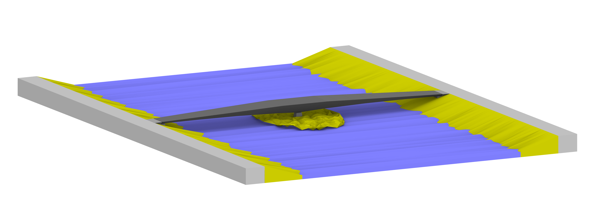

# CBSS WS26/27

In diesem Projekt wird mit Rhino und Grasshopper eine parametrische Hohlkastenbrücke aufgebaut. Das Brückenmodell wird anschließend nach SOFiSTiK exportiert, um dort die statische Berechnung und Bemessung durchzuführen.

## Projektstruktur

- [`rhino_gh/`](rhino_gh/): Rhino-Modell und Grasshopper-Definitionen. [`Gelaende_Edit.3dm`](rhino_gh/Gelaende_Edit.3dm) enthält das Rhino-Modell, [`bridge_flat_plates.gh`](rhino_gh/bridge_flat_plates.gh) die parametrische Grasshopper-Definition.
- [`gh_python/`](gh_python/): Eigenständige Python-Skripte zum Einfügen in die Python-3-Script-Komponenten von Grasshopper (Rhino 8).
- [`sofistik/`](sofistik/): SOFiSTiK-Projekt mit der Haupteingabedatei [`main.dat`](sofistik/main.dat) sowie Berechnungs- und Ergebnisdateien. Im Unterordner [`input/`](sofistik/input/) liegen die exportierte Geometrie [`geometry.dat`](sofistik/input/geometry.dat) und die Lasteingabedatei [`loads.dat`](sofistik/input/loads.dat).

## Python-Skripte

| Skript | Aufgabe |
| --- | --- |
| [`section_block.py`](gh_python/section_block.py) | Erzeugt aus den Querschnittsabmessungen einen Startquerschnitt am Anfang jeder gerichteten, geraden Leitlinie und gibt dessen sieben Randpunkte als JSON in Weltkoordinaten aus. |
| [`section_profile_block.py`](gh_python/section_profile_block.py) | Berechnet den zugehörigen Endquerschnitt aus Startprofil und gewählten Endabmessungen, sodass ebene Mantelflächen entstehen. Optional bleibt die Unterkante auf gleicher Höhe. |
| [`reverse_section_block.py`](gh_python/reverse_section_block.py) | Kehrt die Reihenfolge der Querschnittsrandpunkte um. Der Bezugspunkt und alle Koordinaten bleiben unverändert; das Profil wird nicht gespiegelt. |
| [`hollow_body_block.py`](gh_python/hollow_body_block.py) | Verbindet Start- und Endquerschnitte entlang der Leitlinien zu segmentierten Trägern und erzeugt obere, seitliche und untere Mantelflächen sowie Abschluss- und Zwischenflächen. |
| [`cadinp_port_block.py`](gh_python/cadinp_port_block.py) | Exportiert Linien und Flächen sowie separate Lagerungsgeometrie aus Grasshopper als CADINP-Geometrie für SOFiMSHC. Die erzeugte Datei wird in einen SOFiMSHC-Block eingebunden; Material, Dicken, Querschnitte und Lagerbedingungen werden im SOFiSTiK-Projekt vorgegeben. |

